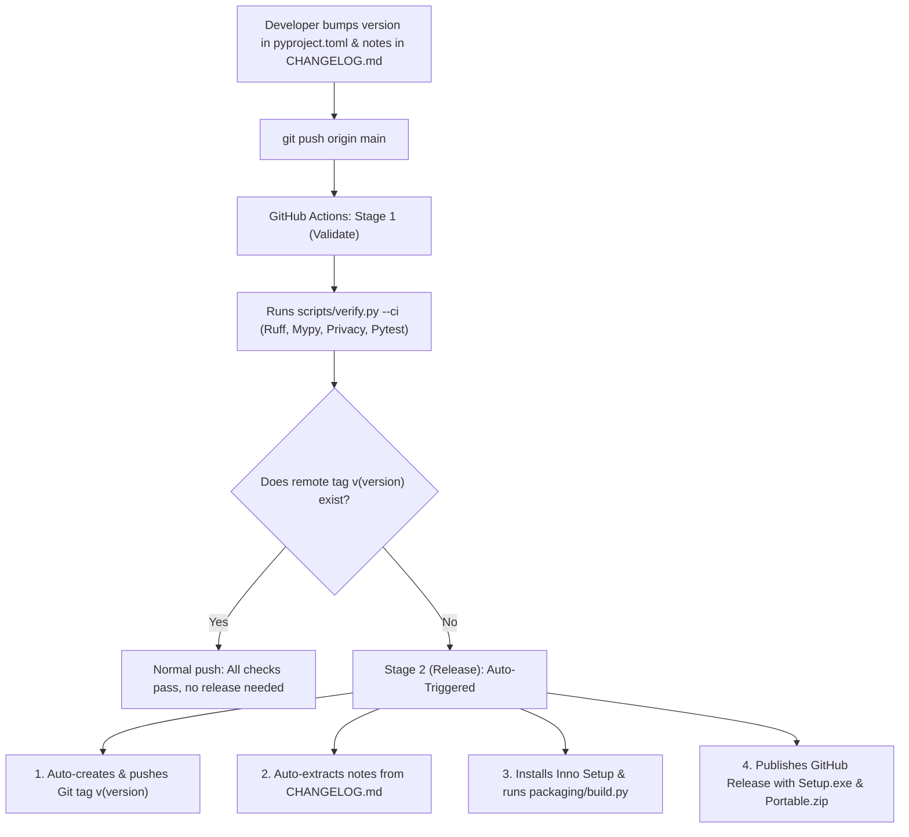

# Versioning, Verification & Automated Release Flow

This document details the single-source-of-truth versioning architecture, local verification, and automated GitHub release pipeline in FastMirror.

---

## 1. Single Source of Truth Versioning

- **Master Version Locator**: The application version is centrally maintained **exclusively** in [`pyproject.toml`](../../pyproject.toml) under `[project].version`:
  ```toml
  [project]
  name = "fast-mirror"
  version = "0.1.0"
  ```
- **Runtime Resolution**: At runtime, [`src.utils.constants.APP_VERSION`](../../src/utils/constants.py) dynamically reads `pyproject.toml` (or `importlib.metadata`) and sets `WINDOW_TITLE = f'FastMirror v{APP_VERSION}'`.
- **Never Hardcode Version Strings**: Never hardcode version strings in source code, GUI labels, or launcher scripts.
- **Strict Semantic Versioning**: Versions MUST strictly follow `MAJOR.MINOR.PATCH` (e.g. `0.1.0`, `0.1.1`, `1.0.0`). Pre-release suffixes are not permitted on the `main` branch.

---

## 2. Changelog Maintenance (`CHANGELOG.md`)

- **Format**: Follows the [Keep a Changelog](https://keepachangelog.com/en/1.0.0/) standard with sections:
  - `### Added`
  - `### Changed`
  - `### Fixed`
  - `### Removed`
- **Release Section Header**: Each release section must match `## [X.Y.Z] - YYYY-MM-DD` (e.g. `## [0.1.0] - 2026-10-31`).
- **User-Facing Focus**: Document changes from the end-user's perspective (new sync features, UI polish, safety checks, bug fixes). Do NOT clutter release notes with internal developer refactors or test fixtures.
- **Automated Extraction**: The GitHub Actions release stage parses `CHANGELOG.md` via regex using the target version and injects the extracted section directly into the GitHub Release body.

---

## 3. Zero-Effort Automated Release Flow



### How to Release
1. Update `version` in `pyproject.toml`.
2. Document user-facing changes under `## [X.Y.Z] - YYYY-MM-DD` in `CHANGELOG.md`.
3. Commit and push directly to `main`:
   ```powershell
   git commit -am "chore: bump version to 0.1.1 and update changelog"
   git push origin main
   ```
4. **Never manually run `git tag` or publish GitHub releases manually**. GitHub Actions automatically handles tag creation, binary compilation, and release publishing.

---

## 4. Local Unified Verification Suite (`scripts/verify.py`)

Always run the unified verification suite locally before committing:

```powershell
# Full validation suite (Format, Lint, MyPy, Privacy, Version, Tests)
uv run python scripts/verify.py --check-version

# Automatically apply formatting and safe lint fixes
uv run python scripts/verify.py --fix
```

### What `verify.py` Validates:
1. **Code Formatting**: `uv run ruff format --check .` (single quotes, 120 character lines).
2. **Linting**: `uv run ruff check .` (catches unused imports, bugs, bad practices).
3. **Type Checking**: `uv run python -m mypy src` (zero type errors allowed).
4. **Privacy & Local Path Prevention**: Scans tracked files to prevent hardcoded user profile paths (`C:\Users\Username\...`, `D:\Projects\...`), personal subnets (`192.168.178.x`), or AI assistant artifact paths.
5. **Version & Changelog Parity**: Ensures `pyproject.toml` version matches `CHANGELOG.md`.
6. **Pytest Test Suite**: Runs the complete test suite (100% pass rate).

---

## 5. Privacy Hygiene & Git Hooks

- **Active Pre-Commit Hook**: Run `git config core.hooksPath .githooks` once to enable local hooks:
  - `.githooks/pre-commit`: Runs the privacy scanner on every commit. If an absolute machine path or personal identifier is detected, the commit is aborted.
  - `.githooks/pre-push`: Runs `scripts/verify.py --check-version` to guarantee 100% parity with CI before pushing.

---

## 6. Packaging & Standalone Windows Executables

- **Frozen Detection**: [`launch.pyw`](../../launch.pyw) bypasses virtual environment re-spawning when `getattr(sys, 'frozen', False)` is `True`.
- **Data Directory Resolution**: [`src.utils.constants`](../../src/utils/constants.py) resolves:
  - Portable mode: Sibling `data/` directory adjacent to `FastMirror.exe` (or `portable.txt` indicator).
  - Installed mode: `%LOCALAPPDATA%\FastMirror\data` (so the app never crashes trying to write into `Program Files`).
- **PyInstaller Specification**: [`packaging/fastmirror.spec`](../../packaging/fastmirror.spec) bundles `sv-ttk`, `ttkwidgets`, `pystray`, icons, and windowed mode (no console popup).
- **Inno Setup Script**: [`packaging/installer.iss`](../../packaging/installer.iss) builds a per-user Setup Wizard (`FastMirror-Setup.exe`) that installs into `%LOCALAPPDATA%\Programs\FastMirror` requiring **zero administrator / UAC elevation**.
