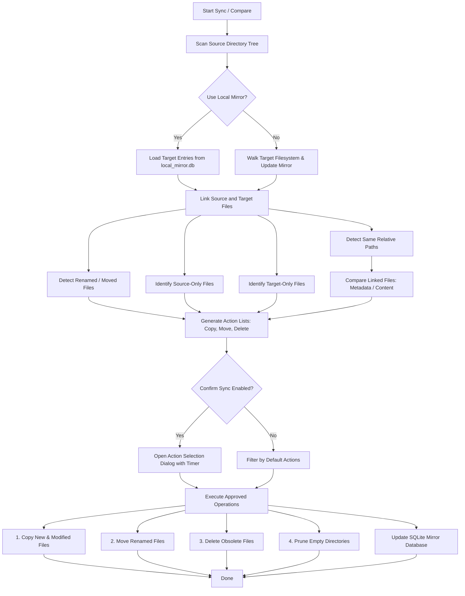

# Automatic Backup Tool

[](https://www.python.org/downloads/)
[](https://www.microsoft.com/windows/)
[](https://github.com/astral-sh/ruff)
[](https://mypy-lang.org/)
[](https://sqlite.org/)

**Automatic Backup Tool** is a high-performance, automated one-way directory synchronization and backup system for Windows. Built with Python and Tkinter, it provides smart change detection, fast network-drive acceleration using a local SQLite mirror index, intelligent file move/rename detection, an interactive confirmation dialog for reviewing actions, and a background task scheduler that docks seamlessly into the Windows system tray.

---

## Table of Contents

- [Key Features](#key-features)
- [How It Works](#how-it-works)
  - [Synchronization Pipeline](#synchronization-pipeline)
  - [Move & Rename Detection](#move--rename-detection)
  - [Local SQLite Mirror Acceleration](#local-sqlite-mirror-acceleration)
- [System Architecture](#system-architecture)
- [Prerequisites & Installation](#prerequisites--installation)
  - [Prerequisites](#prerequisites)
  - [Installation with uv (Recommended)](#installation-with-uv-recommended)
  - [Installation with pip](#installation-with-pip)
- [Usage Guide](#usage-guide)
  - [Launching the Application](#launching-the-application)
  - [Configuring Backup Pairs](#configuring-backup-pairs)
  - [Exclusion Patterns](#exclusion-patterns)
  - [Comparison & Synchronization Options](#comparison--synchronization-options)
  - [Scheduling Automated Backups](#scheduling-automated-backups)
  - [Interactive Action Confirmation Popup](#interactive-action-confirmation-popup)
  - [System Tray Operation](#system-tray-operation)
- [Configuration Reference (`config.json`)](#configuration-reference-configjson)
- [Logging and Excel Reports](#logging-and-excel-reports)
- [Development and Testing](#development-and-testing)
  - [Running Unit Tests](#running-unit-tests)
  - [Linting and Formatting](#linting-and-formatting)
  - [Type Checking](#type-checking)
- [Troubleshooting & FAQs](#troubleshooting--faqs)
- [Additional Documentation](#additional-documentation)
- [License & Author](#license--author)

---

## Key Features

- **Fast One-Way Mirror Synchronization**: Backs up local folders to secondary drives, external hard drives, or remote network shares (UNC paths like `\\192.168.1.100\Backup`).
- **Local SQLite Mirror Indexing (`sqlitedict`)**: Caches target file paths and blake2b metadata hashes in a local `local_mirror.db`. This eliminates the need to scan thousands of files across slow network links on every run.
- **Smart Move & Rename Detection**: Recognizes when files were renamed or moved to different folders on the source side. Rather than deleting and re-uploading large files over the network, it executes local/remote file moves directly on the target.
- **Interactive Action Review**: An interactive treeview dialog previews proposed `COPY`, `MOVE`, and `DELETE` actions with individual file sizes, timestamps, and aggregate group volumes with Windows audio cues.
- **Built-in Weekly Scheduler**: Configure specific days of the week and daily execution times for fully unattended backups.
- **Windows System Tray Integration**: Minimizes to the Windows notification area via native `pystray` integration. Closing the window prompts to keep running in the background.
- **Killable Background Thread**: Long-running comparison and synchronization jobs execute asynchronously in a cancellable thread, keeping the GUI responsive and allowing clean cancellations.
- **Gitwildmatch Exclusions**: Excludes files and folders using `.gitignore`-style wildcard syntax (powered by `pathspec`), pruning ignored directories on the fly during filesystem traversal.
- **Detailed Logging & Excel Audit Reports**: In-GUI color-coded log console with real-time level filtering, persistent log files on disk, and optional detailed Excel (`.xlsx`) comparison reports via `pandas`.
- **Windows Attribute & Long Path Resilience**: Automatically clears read-only attributes on locked target files and detects paths exceeding Windows `MAX_PATH` limits.

---

## How It Works

### Synchronization Pipeline

The backup engine operates in distinct stages:



### Move & Rename Detection

Traditional synchronization scripts treat a renamed or moved file as two separate operations: deleting the target file and copying the source file anew. Over slow connections or Wi-Fi, transferring gigabytes of already-existing data is wasteful.

The `automatic-backup` linking algorithm:
1. First correlates files that share the exact same relative path from their respective roots.
2. For remaining unlinked files, it matches files possessing unique filenames and identical metadata (size and modification time hash).
3. Matched files with differing relative paths are flagged for a quick `shutil.move()` operation directly on the target, followed by a mirror database key update.

### Local SQLite Mirror Acceleration

Scanning tens of thousands of files across a slow SMB/CIFS network share can take several minutes. When the **"Use fast scan based on local mirror"** option is enabled:
- The target file catalog is loaded from a local SQLite database (`local_mirror.db`).
- Each directory pair and unique exclusion set has an isolated table.
- File records store an 8-byte `blake2b` digest of the file's `(st_size, st_mtime)`.
- File operations (`copy`, `move`, `delete`) keep the mirror database updated incrementally.
- Users can trigger a clean rescan anytime using the **"Rebuild local mirror"** option.

---

## System Architecture

The codebase is organized into modular packages:

```
automatic-backup/
├── config.json               # Persistent user configuration
├── launch.pyw                # Windowless Windows launcher with auto-venv detection
├── local_mirror.db           # SQLite database for cached target mirrors
├── pyproject.toml            # Project metadata, dependencies, and tool settings
├── logs/                     # Session log files and generated Excel reports
├── notebooks/                # Exploratory & diagnostic Jupyter notebooks
│   ├── explore_db.ipynb
│   └── tests.ipynb
├── src/
│   ├── core/
│   │   ├── backend.py        # CompareDirs, SyncDirs orchestration engine
│   │   ├── file_ops.py       # Robust atomic file operations (copy, move, delete, unlock)
│   │   ├── path_resolver.py  # Path conversions & specificity-scored root resolution
│   │   ├── file.py           # CstmPath, File abstractions, hash calculation
│   │   └── mirror.py         # MirrorDatabase SQLite manager
│   ├── gui/
│   │   ├── gui.py            # Main application orchestrator, watchdogs, scheduler
│   │   ├── confirmation_popup.py # ActionSelection modal & CustomCheckboxTreeView
│   │   ├── health_check.py   # Non-blocking target reachability & disk space prober
│   │   ├── tray.py           # TrayableTk system tray integration
│   │   ├── enums.py          # Tkinter & Thread state enums
│   │   ├── worker_thread.py  # WorkerThread background execution & cooperative cancellation
│   │   ├── widgets.py        # Custom Tkinter controls (Paths, Exclusions, Loggers)
│   │   ├── components/       # Modular GUI panels (Actions, Log, Paths, Schedule, Status, Telemetry)
│   │   └── app_icon.ico      # Application and tray icon
│   └── utils/
│       ├── constants.py      # ROOT_DIR locator
│       ├── logger.py         # Context-aware singleton logger with test mode isolation
│       └── utils.py          # Helpers (formatting, progress logging, paths)
└── tests/
    ├── conftest.py           # Test isolation fixtures
    ├── test_e2e.py           # End-to-end integration workflows
    ├── test_paths.py         # Path resolution and UNC share tests
    ├── test_file_ops.py      # Robust file operations, locks, and retries
    ├── test_sync.py          # Directory synchronization & comparison
    ├── test_mirror.py        # SQLite WAL mirror database tests
    ├── test_confirmation_popup.py # Action confirmation popup & treeview
    ├── test_gui.py           # GUI scheduler, settings, and TextLogger
    ├── test_logger.py        # Logging handlers and log isolation
    └── TestData/             # Local directory pairs for testing
```

---

## Prerequisites & Installation

### Prerequisites

- **Operating System**: Windows 10 or Windows 11 (uses Windows-specific APIs: `ctypes.windll.kernel32`, `winsound`).
- **Python**: Version **3.10** or higher.
- **Package Manager**: [uv](https://github.com/astral-sh/uv) (recommended) or standard `pip`.

### Installation with uv (Recommended)

1. **Clone the repository:**
   ```powershell
   git clone https://github.com/rafaelsavi/automatic-backup.git
   cd automatic-backup
   ```

2. **Create the virtual environment and install dependencies:**
   ```powershell
   uv venv
   .\.venv\Scripts\activate
   uv pip install -e .
   ```

3. **Install development dependencies (optional):**
   ```powershell
   uv pip install -e ".[dev]"
   ```

### Installation with pip

1. **Create and activate a virtual environment:**
   ```powershell
   python -m venv .venv
   .\.venv\Scripts\activate
   ```

2. **Install the package in editable mode:**
   ```powershell
   pip install -e .
   ```

3. **Install dev dependencies:**
   ```powershell
   pip install -e ".[dev]"
   ```

---

## Usage Guide

### Launching the Application

You can launch the application in several ways:

1. **Windowless Launcher (`launch.pyw`)**:
   Double-click `launch.pyw` in Windows Explorer or run from PowerShell:
   ```powershell
   pythonw launch.pyw
   ```
   *`launch.pyw` automatically detects and invokes the Python executable inside `.venv` without opening an unwanted command-prompt console.*

2. **Standard Module Execution**:
   ```powershell
   uv run python -m gui.gui
   ```
   or with an activated virtual environment:
   ```powershell
   python -m gui.gui
   ```

---

### Configuring Backup Pairs

In the upper-right section of the main window (**Paths**):

1. Click **Add new** to choose a **Source folder** followed by a **Destination folder** using standard Windows folder selection dialogs.
2. The folder pair appears in the text area formatted as:
   ```text
   D:\Photos -> \\192.168.1.100\Backup\Photos
   E:\Documents -> F:\Backup\Documents
   ```
3. You can also edit this box manually. Each line must follow the `SOURCE -> TARGET` syntax.
4. Paths are validated automatically: the source folder must exist, and the target folder (or its parent directory) must exist.

---

### Exclusion Patterns

In the **Exclusions** field, supply comma-separated glob patterns adhering to `.gitignore` (`gitwildmatch`) rules:

```text
$RECYCLE.BIN, **\.git\**, **\.venv\**, **\__pycache__\**, **\~$*, Filmes, Jogos
```

- Directories matching these patterns are skipped during filesystem traversal, significantly accelerating directory scans.
- Leading/trailing whitespace is stripped automatically.

---

### Comparison & Synchronization Options

| Option Checkbox | Description | Recommended Setting |
| :--- | :--- | :---: |
| **Use fast scan based on local mirror** | Skips scanning the target storage on disk; loads target files from `local_mirror.db`. | **ON** (especially for NAS / slow drives) |
| **Rebuild local mirror** | Resets the target's SQLite mirror table and performs a full scan from disk to re-index. Automatically unchecks fast scan. | **OFF** (use only when target changed externally) |
| **Use fast comparison based on metadata** | Compares `st_size` and `st_mtime` via an 8-byte blake2b digest. If disabled, performs full byte-by-byte file comparison. | **ON** |
| **Request confirmation before sync** | Prompts with an interactive review table before writing any changes. | **ON** |
| **Save detailed report** | Generates an Excel spreadsheet (`logs/compare_report_*.xlsx`) documenting every analyzed file status. | **Optional** |

#### Default Actions
Check or uncheck which actions are enabled by default in the confirmation dialog:
- **Copy**: New files and modified files.
- **Move**: Files detected as moved/renamed.
- **Delete**: Obsolete files residing in the target that no longer exist in the source.

---

### Scheduling Automated Backups

1. Select the desired **Week days** (e.g. `MON`, `WED`, `FRI`, `SUN`).
2. In the **Times** field, enter execution times in 24-hour `HH:MM` format, one per line (e.g. `20:30`).
3. Click the **Schedule (OFF)** toggle button. It will switch to **Schedule (ON)** and depress.
4. The **Next synchronization** field will display the exact date, time, and day of the week for the upcoming job.
5. Click **Save** under *GUI Configuration* to store the schedule so it persists across restarts.

---

### Interactive Action Confirmation Popup

When synchronization begins with **"Request confirmation before sync"** enabled, a dedicated modal appears:

- **Categorized Treeview**: Displays expandable groups for **copy**, **move**, and **delete** with individual file sizes, source paths, destination paths, and modification dates.
- **Live Group Statistics**: Group headers dynamically update with the total byte size and count of selected items (e.g. `copy 1.45GB (32 of 32)`).
- **Controls**:
  - **Save and continue**: Immediately executes checked actions.
  - **Cancel**: Aborts the operation without touching files.

---

### System Tray Operation

- **Minimizing**: Clicking the standard window Minimize button (`_`) hides the window and docks the application into the Windows system tray with the sync icon.
- **Closing**: Clicking the window Close button (`X`) triggers a prompt offering to minimize to the tray instead of exiting.
- **Restoring**: Double-click or single-click the system tray icon, or right-click to open the context menu and select **Open**.
- **Exiting**: Right-click the system tray icon and select **Quit**.

---

## Configuration Reference (`config.json`)

All GUI settings are saved to `config.json` in the root directory. Below is a documented example:

```json
{
    "entry_paths": [
        [
            "D:\\",
            "\\\\192.168.1.100\\Backup\\D"
        ],
        [
            "E:\\Photos\\Family",
            "\\\\192.168.1.100\\Photos-Family"
        ]
    ],
    "week_days": [
        "TUE",
        "FRI",
        "SUN"
    ],
    "entry_times": [
        "20:30"
    ],
    "entry_exclusions": [
        "$RECYCLE.BIN",
        "**\\.git\\**",
        "**\\.venv\\**",
        "**\\__pycache__\\**",
        "**\\~$*",
        "Filmes",
        "Jogos"
    ],
    "log_levels": [
        "INFO",
        "WARNING",
        "ERROR",
        "CRITICAL"
    ],
    "checkbox_default_actions": [
        "copy",
        "move",
        "delete"
    ],
    "checkbox_var_use_mirror": true,
    "checkbox_var_build_mirror": false,
    "checkbox_var_metadata_comparison": true,
    "checkbox_var_confirm_sync": true,
    "checkbox_var_save_report": false
}
```

### Configuration Keys

| Key | Type | Description |
| :--- | :--- | :--- |
| `entry_paths` | `list[list[str, str]]` | List of `[source_directory, target_directory]` pairs. |
| `week_days` | `list[str]` | List of enabled days: `["MON", "TUE", "WED", "THU", "FRI", "SAT", "SUN"]`. |
| `entry_times` | `list[str]` | List of scheduled execution times in `HH:MM` format. |
| `entry_exclusions` | `list[str]` | List of gitwildmatch pattern strings to exclude. |
| `log_levels` | `list[str]` | Active logging levels visible in GUI: `DEBUG`, `INFO`, `WARNING`, `ERROR`, `CRITICAL`. |
| `checkbox_default_actions` | `list[str]` | Default enabled actions in the popup: `"copy"`, `"move"`, `"delete"`. |
| `checkbox_var_use_mirror` | `bool` | Whether to scan target files from local SQLite database. |
| `checkbox_var_build_mirror` | `bool` | Whether to wipe and rebuild the target's SQLite mirror table. |
| `checkbox_var_metadata_comparison` | `bool` | `true` for fast metadata hashing; `false` for byte content comparison. |
| `checkbox_var_confirm_sync` | `bool` | `true` to require interactive confirmation before syncing. |
| `checkbox_var_save_report` | `bool` | `true` to export an Excel file for each comparison. |

---

## Logging and Excel Reports

### Real-Time GUI Logger
The bottom-right panel displays real-time logs routed through a thread-safe `queue.Queue`.
- **Level Filters**: Check or uncheck log levels (`DEBUG`, `INFO`, `WARNING`, `ERROR`, `CRITICAL`) to filter visible messages on the fly.
- **Auto-scroll**: Keeps the text widget scrolled to the latest entry.
- **Color Coding**: Gray for debug, black for info, orange for warnings, red for errors, and underlined red for critical issues.

### Persistent Files
- All events are automatically logged with timestamps to `logs/log_YYYY-MM-DD_HH-MM-SS.txt`.
- When **Save detailed report** is checked, an Excel workbook `logs/compare_report_YYYY-MM-DD_HH-MM-SS.xlsx` is generated with columns for file path, file size, modification dates, status (`only source`, `only target`, `moved`, `modified`, `same`), and comparison errors.
- Click **Open last report** in the GUI to immediately open the most recent Excel file in Microsoft Excel or your default spreadsheet handler.

---

## Development and Testing

### Running Unit Tests

The test suite uses [pytest](https://docs.pytest.org/):

```powershell
uv run pytest
```
or
```powershell
pytest
```

To run with verbose output:
```powershell
pytest -v tests/test_mirror.py
```

### Linting and Formatting

The project enforces code style using [Ruff](https://github.com/astral-sh/ruff):

```powershell
# Check for lint errors
uv run ruff check .

# Automatically fix fixable issues
uv run ruff check --fix .

# Check code formatting
uv run ruff format --check .

# Apply formatting
uv run ruff format .
```

Configuration highlights (`pyproject.toml`):
- Line length: `120`
- Target Python version: `py310`
- Quote style: Single quotes (`'`)
- Enabled rules: Flake8, Bugbear, Isort, Simplify, Pyupgrade, Docstrings.

### Type Checking

Type annotations are validated with [mypy](https://mypy-lang.org/):

```powershell
uv run mypy src
```

---

## Troubleshooting & FAQs

### 1. "Mirror does not exist for target directory... Using file system instead"
- **Cause**: Fast scan is enabled, but the database table has not been populated yet.
- **Resolution**: Let the first run complete; it will scan the filesystem and populate the mirror automatically for subsequent runs.

### 2. Permission errors when overwriting target files
- **Cause**: Target files may have the Windows read-only attribute set or are locked by another process.
- **Resolution**: `SyncDirs` attempts to clear read-only file attributes via `ctypes.windll.kernel32.SetFileAttributesW`. If another application (like Lightroom or Word) has an exclusive lock, close that application and rerun.

### 3. File paths exceeding Windows 260 character limit (`MAX_PATH`)
- **Cause**: Deep folder hierarchies can exceed the legacy 260-character Windows path limit.
- **Resolution**: Enable Windows Long Paths in the Windows Registry (`LongPathsEnabled = 1` in `HKLM\SYSTEM\CurrentControlSet\Control\FileSystem`) or shorten top-level folder names.

### 4. System tray icon does not appear
- **Cause**: The application uses `pystray` to dock in the Windows notification area. If system tray initialization fails, a warning is logged while the main GUI continues running.

---

## Additional Documentation

For deeper technical breakdowns, consult the dedicated guides in the [`docs/`](file:///d:/Rafael/Projects/Python/automatic-backup/docs) folder:

- [System Architecture & Synchronization Engine](file:///d:/Rafael/Projects/Python/automatic-backup/docs/ARCHITECTURE.md)
- [Configuration & Exclusion Patterns Guide](file:///d:/Rafael/Projects/Python/automatic-backup/docs/CONFIGURATION.md)
- [Development, Testing & Contribution Guidelines](file:///d:/Rafael/Projects/Python/automatic-backup/docs/DEVELOPMENT.md)

---

## License & Author

**Author**: Rafael Savi  
**Project**: `automatic-backup`  
**License**: Proprietary / Personal Project (All rights reserved).
