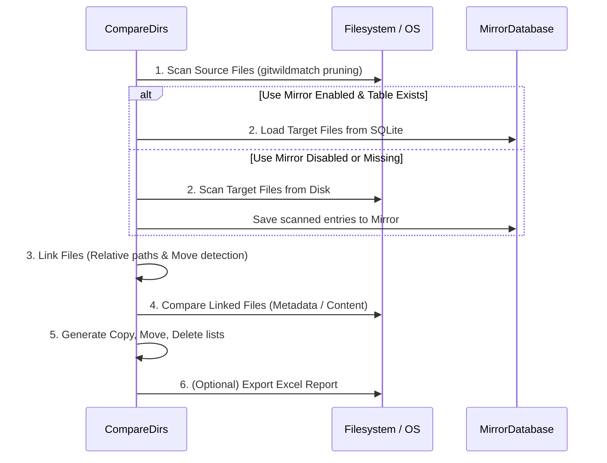

# System Architecture & Synchronization Engine

This document provides an in-depth technical analysis of the design, internal data models, threading architecture, and algorithms implemented in **Automatic Backup Tool**.

---

## Table of Contents

1. [High-Level Architectural Overview](#high-level-architectural-overview)
2. [Core Data Models & File Abstractions](#core-data-models--file-abstractions)
   - [CstmPath](#cstmpath)
   - [Metadata Stats & StatsHash](#metadata-stats--statshash)
   - [File Class & State Machine](#file-class--state-machine)
3. [The Comparison Engine (`CompareDirs`)](#the-comparison-engine-comparedirs)
   - [1. Scanning Phase](#1-scanning-phase)
   - [2. Linking Phase](#2-linking-phase)
   - [3. Comparison Phase](#3-comparison-phase)
   - [4. Action Categorization Phase](#4-action-categorization-phase)
   - [5. Reporting Phase](#5-reporting-phase)
4. [The Synchronization Engine (`SyncDirs`)](#the-synchronization-engine-syncdirs)
   - [Copy Execution & Permission Recovery](#copy-execution--permission-recovery)
   - [Move Execution](#move-execution)
   - [Deletion Execution](#deletion-execution)
   - [Protected Empty Directory Pruning](#protected-empty-directory-pruning)
5. [The Local Mirror Database (`MirrorDatabase`)](#the-local-mirror-database-mirrordatabase)
   - [Isolation & Table Name Derivation](#isolation--table-name-derivation)
   - [Incremental Maintenance](#incremental-maintenance)
6. [GUI & Concurrency Architecture](#gui--concurrency-architecture)
   - [WorkerThread & Cooperative Cancellation](#workerthread--cooperative-cancellation)
   - [Watchdog State Machine](#watchdog-state-machine)
   - [Thread-Safe Logging](#thread-safe-logging)
   - [Custom TreeView with Dynamic Grouping](#custom-treeview-with-dynamic-grouping)
   - [System Tray via Winico Tcl Extension](#system-tray-via-winico-tcl-extension)

---

## High-Level Architectural Overview

The application is structured into three clean layers:

```
┌────────────────────────────────────────────────────────┐
│                   GUI Layer (Tkinter)                  │
│  [Gui] ─── [TrayableTk] ─── [CustomCheckboxTreeView]   │
│         │                                              │
│         ▼                                              │
│  [WorkerThread] (Background Worker)                    │
└─────────┬──────────────────────────────────────────────┘
          │
          ▼
┌────────────────────────────────────────────────────────┐
│                  Core Engine Layer                     │
│  [CompareDirs] ───────────────► [SyncDirs]             │
│        │                              │                │
│        ▼                              ▼                │
│  [File / CstmPath]           [File Operations]         │
└─────────┬─────────────────────────────┬────────────────┘
          │                             │
          ▼                             ▼
┌────────────────────────────────────────────────────────┐
│               Storage & Database Layer                 │
│  [MirrorDatabase (SqliteDict)]  [Filesystem / Network] │
└────────────────────────────────────────────────────────┘
```

- **GUI Layer (`src/gui/`)**: Manages user interaction, preferences, background thread lifecycles, real-time log routing, and system tray minimization.
- **Core Engine Layer (`src/core/`)**: Houses filesystem traversal, metadata extraction, file linking, move/rename detection, and disk synchronization.
- **Storage Layer**: SQLite (`local_mirror.db`) for caching and persistent log/report files in `logs/`.

---

## Core Data Models & File Abstractions

Implemented in [`src/core/file.py`](file:///d:/Rafael/Projects/Python/automatic-backup/src/core/file.py).

### CstmPath

`CstmPath` inherits from Python's standard `pathlib.Path`. It enhances the path object with root-relative context and cached stat metrics:

- **`root_dir`**: Identifies the base folder under which the path was discovered. Validates that `root_dir in self.parents`.
- **`rel_to_root`**: Cached relative path string (`Path(self).relative_to(self.root_dir)`).
- **`as_target(dirs)`**: Maps a source path to its corresponding destination root based on configured directory pairs.
- **Operator Overloads**: Overrides `__truediv__` (`/`) and `__rtruediv__` so that subpath division returns a `CstmPath` instance preserving `root_dir`.

### Metadata Stats & StatsHash

To evaluate whether two files are identical without reading their entire payload:

1. `_get_stats(path)` extracts `Stats(st_size, st_mtime)`.
2. `_encode_stats(stats)` computes an 8-byte hexadecimal hash using the fast BLAKE2b algorithm:
   ```python
   StatsHash(hashlib.blake2b(str(stats).encode(), digest_size=8).hexdigest())
   ```
3. This 16-character string provides a collision-resistant fingerprint of size and modification timestamp, compact enough to store millions of entries in SQLite with minimal overhead.

### File Class & State Machine

The `File` class pairs a source `CstmPath` and/or a target `CstmPath`. A file exists in one of several mutually exclusive or composite states:

```
            ┌───────────────────┐
            │       File        │
            └─────────┬─────────┘
                      │
     ┌────────────────┼────────────────┐
     ▼                ▼                ▼
[only_source]     [in_both]      [only_target]
 (Source Only)        │          (Target Only)
                      ├────────────────┐
                      ▼                ▼
                 [not moved]        [moved]
                      │          (Same metadata,
              ┌───────┴───────┐   diff rel-path)
              ▼               ▼
           [same]        [modified]
       (Metadata match) (Metadata differ)
```

- **`only_source`**: Target is `None`. File will be copied to destination.
- **`only_target`**: Source is `None`. File is obsolete and will be deleted from destination.
- **`in_both`**: Both source and target exist.
- **`moved`**: Both source and target exist, and their `rel_to_root` paths differ.
- **`same`**: File content/metadata matches. No operation required.
- **`modified`**: Metadata differs. File will be overwritten by source.
- **`compare_error`**: File comparison failed (e.g. access denied). Skipped from action lists to prevent destructive mistakes.

---

## The Comparison Engine (`CompareDirs`)

Implemented in [`src/core/backend.py`](file:///d:/Rafael/Projects/Python/automatic-backup/src/core/backend.py).

`CompareDirs` executes a strict five-phase workflow:



### 1. Scanning Phase
- Utilizes `os.walk()` combined with `pathspec.PathSpec` (gitwildmatch mode).
- In-place directory pruning (`dirs[:] = [d for d in dirs if not spec.match_file(...)]`) prevents `os.walk` from descending into ignored directory trees (`.git`, `node_modules`, `.venv`), dramatically reducing disk I/O.

### 2. Linking Phase
File linking correlates source and target entries in 4 sequential passes:

1. **Relative Path Exact Match**:
   Iterates through source files. If `target_rel_paths.get(source_file.rel_to_root)` exists, creates a `File(source, target)`. Both are removed from unlinked sets.
2. **Move & Rename Detection**:
   Examines remaining unlinked files where the filename is unique within both source and target sets (`Counter(f.name) == 1`). If the filenames match and their metadata hashes match, creates a `File(source, target)` marked as `moved=True`.
3. **Source-Only Accumulation**:
   Remaining unlinked source files are marked as `only_source=True`.
4. **Target-Only Accumulation**:
   Remaining unlinked target files are marked as `only_target=True`.

### 3. Comparison Phase
For all files existing in both directories that are not moved:
- **`CompareMethod.METADATA`**: Compares `f1.stats_hash == f2.stats_hash`.
- **`CompareMethod.CONTENT`**: Uses `filecmp.cmp(f1, f2, shallow=False)` to verify byte-level equality.

### 4. Action Categorization Phase
- **`files_to_copy`**: Includes `only_source` files and `modified` files.
- **`files_to_move`**: Includes `moved` files (relocating `f.target -> f.source_as_target`).
- **`files_to_delete`**: Includes `only_target` files.

### 5. Reporting Phase
When enabled, builds a pandas DataFrame containing all evaluated files (filtering out unchanged files to save memory) and writes a timestamped spreadsheet to `logs/compare_report_YYYY-MM-DD_HH-MM-SS.xlsx`.

---

## The Synchronization Engine (`SyncDirs`)

Implemented in [`src/core/backend.py`](file:///d:/Rafael/Projects/Python/automatic-backup/src/core/backend.py).

`SyncDirs` executes user-approved operations in an optimized four-phase sequence to maximize available storage and avoid path collisions:

1. **Move Phase (`move_files`)**: Relocates existing target files to their new relative paths first. On the same destination volume, this is a metadata-only rename that consumes zero extra storage and immediately clears original paths.
2. **Delete Phase (`delete_files`)**: Removes obsolete target files using `robust_delete()`, reclaiming disk space on the destination drive before any new data is transferred.
3. **Copy Phase (`copy_files`)**: Transfers new and modified files using `robust_copy()`, having maximum available disk space headroom.
4. **Pruning Phase (`delete_empty_dirs`)**: Cleans up newly-orphaned empty folders left behind by moves and deletions, with strict root protection.

### Network Share Resilience & Retries (`robust_copy`, `robust_move`, `robust_delete`)

When backing up to local network shares (SMB/CIFS / UNC paths such as `\\192.168.1.100\...`), operations are vulnerable to transient network drops (`WinError 64: network name no longer available`, `WinError 53: network path not found`, `WinError 59: unexpected network error`, `WinError 121: semaphore timeout`) and momentary file locks (`WinError 32: sharing violation`, `PermissionError: Access is denied`).

To ensure robustness, all filesystem mutations use retry mechanisms with exponential backoff:

1. **`robust_copy(source, target, max_retries=3, initial_delay=1.0, backoff_factor=2.0)`**:
   - Ensures the target directory exists (`os.makedirs`).
   - Copies file and metadata timestamps via `shutil.copy2`.
   - On transient failure (`OSError`, `PermissionError`):
     - Automatically invokes `unlock_file_attributes(target)` to clear read-only/hidden/system attributes using `ctypes.windll.kernel32.SetFileAttributesW(0x80)` (`FILE_ATTRIBUTE_NORMAL`) and `os.chmod(stat.S_IWRITE)`.
     - Retries with exponential backoff (`delay *= backoff_factor`).
   - **Corrupt / Incomplete Target Cleanup**: If all retries are exhausted and the copy fails, any partial or incomplete target file created during the operation is automatically cleaned up with `os.remove` to prevent target corruption in backup repositories.

2. **`robust_move(source, target, max_retries=3, initial_delay=1.0, backoff_factor=2.0)`**:
   - Executes `shutil.move(source, target)`.
   - On failure, unlocks attributes on both target and source and retries with backoff.
   - If a cross-filesystem move fails during the copy phase, cleans up partial destination files before re-raising.

3. **`robust_delete(path, max_retries=3, initial_delay=1.0, backoff_factor=2.0)`**:
   - Unlocks attributes and removes file with `os.remove`.
   - Retries on permission or lock errors.

4. **Mirror Synchronization**:
   - On copy success: adds target path and BLAKE2b hash to `MirrorDatabase`.
   - On move success: replaces source path with target path in `MirrorDatabase`.
   - On delete success: removes target path from `MirrorDatabase`.
   - Calculates and logs transfer speed (`Avg. copy speed: XX MB/s`).

### Protected Empty Directory Pruning
After files are deleted or moved, orphan empty folders can clutter the target:
1. Gathers directories containing deleted or moved files.
2. Sorts directories in descending order of string length (`reverse=True`) so child subdirectories are deleted before parent folders.
3. **Root Protection**: Asserts that normalized directory paths are not root source or target paths:
   ```python
   protected_roots = {os.path.realpath(dir_pair.target).lower() for dir_pair in self.dirs}
   protected_roots.update({os.path.realpath(dir_pair.source).lower() for dir_pair in self.dirs})
   ```
4. If empty (`not os.listdir(dir_path)`), calls `os.rmdir(dir_path)`.

---

## The Local Mirror Database (`MirrorDatabase`)

Implemented in [`src/core/mirror.py`](file:///d:/Rafael/Projects/Python/automatic-backup/src/core/mirror.py).

### Isolation & Table Name Derivation
The mirror manages a single SQLite database (`local_mirror.db`) backed by `sqlitedict`. To ensure different directories or different exclusion sets do not cross-contaminate:

- Table names are generated by combining the sanitized root path with a sanitized string of sorted exclusion rules:
  ```python
  def _generate_table_name(self, root_dir: str | PathLike[str]) -> str:
      sanitized_root = sanitize_path(root_dir).replace(os.sep, '_').replace(':', '_')
      sanitized_exclusions = '_'.join(e.replace(os.sep, '_').replace(':', '_') for e in self.exclusions)
      allowed_pattern = r'[^a-zA-Z0-9_]'
      sanitized_root = re.sub(allowed_pattern, '_', sanitized_root)
      sanitized_exclusions = re.sub(allowed_pattern, '_', sanitized_exclusions)
      return f'{sanitized_root}__{sanitized_exclusions}'
  ```

### Incremental Maintenance
- **Addition**: Key is sanitized filepath; value is `StatsHash`.
- **Removal**: Key is deleted from table.
- **Replacement**: Atomic remove + add.
- **Reset**: Table is cleared (`db.clear()`) when rebuilding the mirror.

---

## GUI & Concurrency Architecture

### WorkerThread & Cooperative Cancellation
Implemented in [`src/gui/worker_thread.py`](file:///d:/Rafael/Projects/Python/automatic-backup/src/gui/worker_thread.py).

Background synchronization and comparison run asynchronously in a dedicated `WorkerThread` that uses purely cooperative cancellation via `threading.Event`:

```python
class WorkerThread(threading.Thread):
    def __init__(self, *args, cancel_event: threading.Event | None = None, **kwargs):
        super().__init__(*args, **kwargs)
        self.cancel_event = cancel_event if cancel_event is not None else threading.Event()
        self.exc: BaseException | None = None

    def cancel(self):
        self.cancel_event.set()
```

When cancellation is requested (either via the UI Stop button, tray icon, or scheduler disable), `cancel()` sets the cancellation event. The core loops in `CompareDirs` and `SyncDirs` check `cancel_requested.is_set()` at every file iteration, aborting safely between operations without corrupting filesystem state, leaking file locks, or imposing `sys.settrace` interpreter overhead.

### Watchdog State Machine
Implemented in [`src/gui/gui.py`](file:///d:/Rafael/Projects/Python/automatic-backup/src/gui/gui.py).

The GUI uses a recursive Tkinter timer (`root.after()`) for non-blocking monitoring:
- **`backend_watchdog`**: Polls every 1000ms in `STANDBY` mode (or 50ms when transitioning). Checks if a scheduled appointment has arrived, or if a manual button was pressed.
- **State transitions**:
  - `STANDBY`: Inputs enabled, schedule active.
  - `RUNNING`: Inputs disabled, active action button sunken.
  - `STOPPING`: Cancellation requested, inputs disabled until thread exits.

### Thread-Safe Logging
Implemented in [`src/utils/logger.py`](file:///d:/Rafael/Projects/Python/automatic-backup/src/utils/logger.py).

Tkinter widgets cannot be safely updated from secondary threads. To ensure thread safety:
1. `Logger` registers a custom `QueueHandler` writing to a Python `queue.Queue`.
2. A dedicated Tkinter watchdog (`log_queue_watchdog`) polls the queue in the main thread and inserts formatted text records into `TextLogger`.

### Custom TreeView with Dynamic Grouping
Implemented in [`src/gui/confirmation_popup.py`](file:///d:/Rafael/Projects/Python/automatic-backup/src/gui/confirmation_popup.py).

`CustomCheckboxTreeView` (derived from `ttkwidgets.CheckboxTreeview`):
- Groups proposed changes by `copy`, `move`, and `delete`.
- Listens to checkbox toggles via `_box_click`.
- Dynamically recalculates group header text to show real-time selection metrics:
  ```text
  copy 2.40GB (15 of 20)
  ```

### System Tray via Pystray
Implemented in [`src/gui/tray.py`](file:///d:/Rafael/Projects/Python/automatic-backup/src/gui/tray.py).

Windows-native notification tray docking is provided via `pystray`:
- Pure Python using native Windows API (`Shell_NotifyIconW`) without requiring any compiled binary DLLs.
- Supports native `.ico` icon loading via Pillow (`PIL.Image`).
- Provides background-threaded execution (`icon.run_detached()`) with context menu options ("Open", "Quit") and double-click window restoration.
